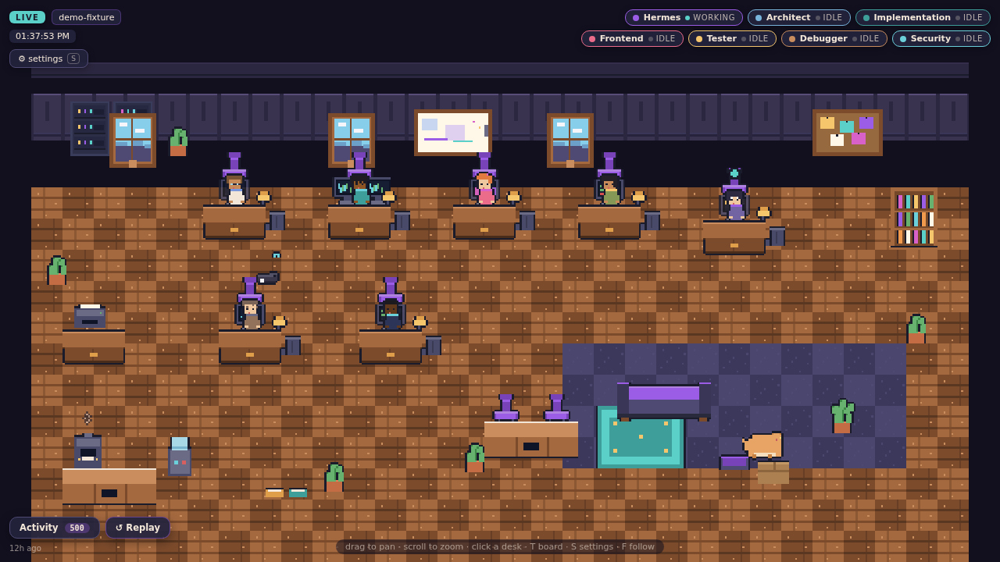
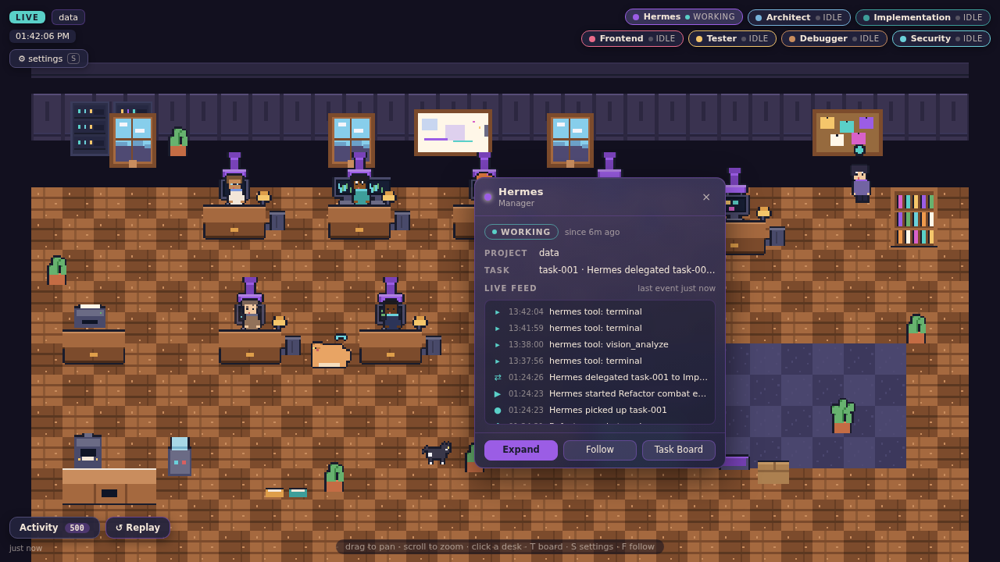
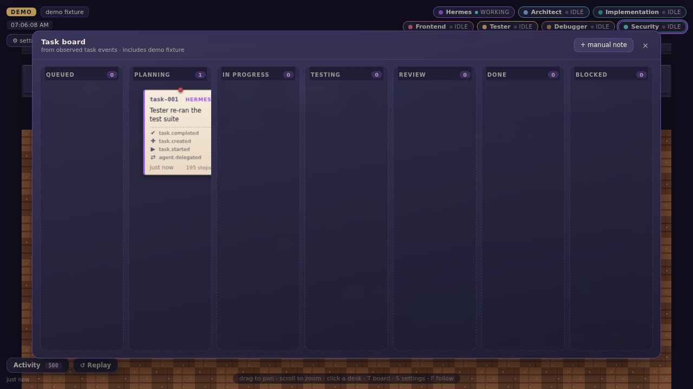
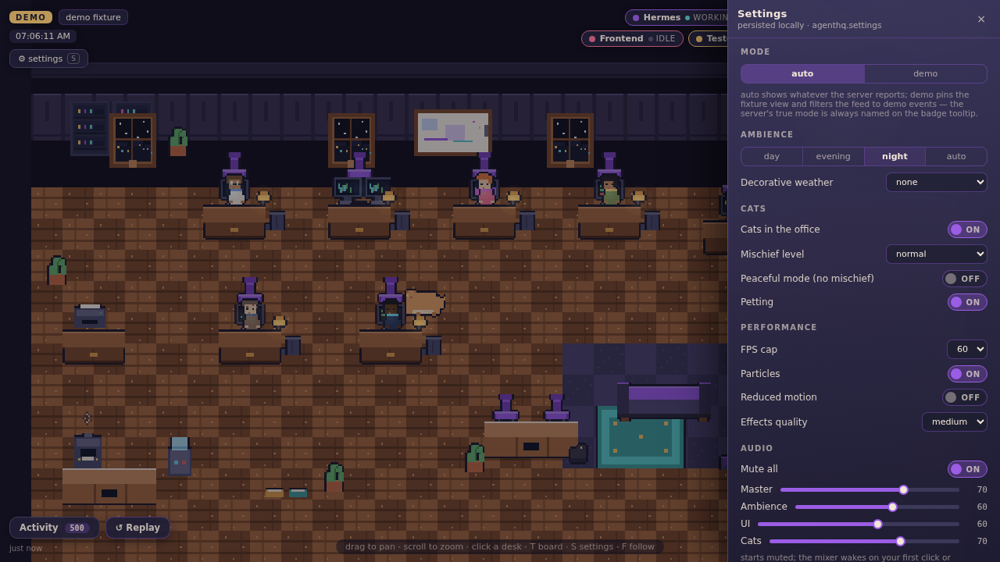
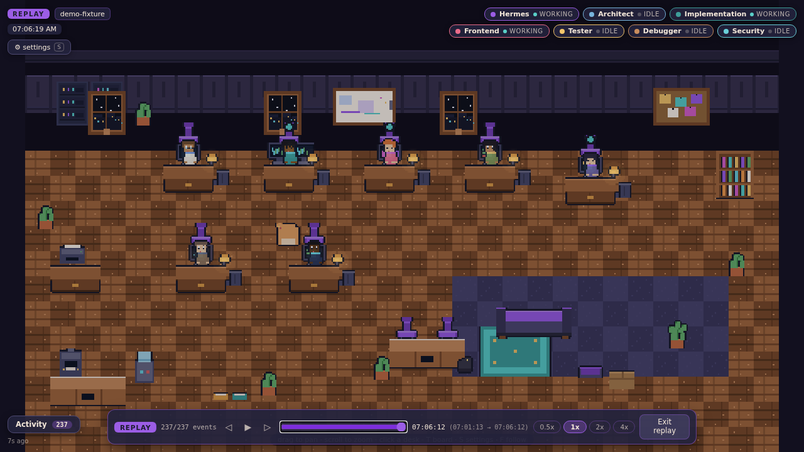
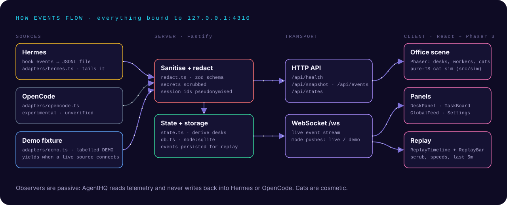

<p align="center">
  
</p>

<p align="center">
  <b>A cosy pixel-art office where your local AI team actually works.</b><br/>
  Hermes runs the floor, six OpenCode specialists staff their desks, and two cats cause absolutely no production incidents.
</p>

<p align="center">
  
  
  
  
  
</p>

---

## What is AgentHQ?

Most agent dashboards are a wall of logs. **AgentHQ turns them into a place you can look at.** Every desk in the office
is bound to a real agent ID from the live runtime. Click a desk and you get a serious, sanitised view of what that agent
is doing right now: sessions, tool calls, files and a replayable timeline.

Three ideas set it apart:

- 🏢 **A little world worth leaving open.** Pixel art, warm lamps, day and night ambience, idle animations, and two cats with personalities.
- 🖥️ **Serious observability in a game costume.** Every desk opens a live, filterable, replayable view of actual agent activity.
- 📡 **Truthful by design.** Only observed events are shown, everything carries provenance, and **LIVE / DEMO / REPLAY / STALE / DISCONNECTED** badges never lie.

## Visual tour

<p align="center">
  
  <br/><sub><b>Real screenshot</b> of the office with Hermes connected live. Status chips are along the top, and the Activity and Replay controls are at the bottom.</sub>
</p>

<table>
  <tr>
    <td width="50%"><br/><sub>Click a desk: the Hermes panel with its live feed</sub></td>
    <td width="50%"><br/><sub>Press <kbd>T</kbd>: the task board</sub></td>
  </tr>
  <tr>
    <td width="50%"><br/><sub>Night shift lighting</sub></td>
    <td width="50%"><br/><sub>Replay: scrub through the last few minutes</sub></td>
  </tr>
</table>

<sub>The screenshots above are real captures from <code>docs/evidence/</code>, taken during verification runs. The banner at the top is an illustration.</sub>

## Features

<table>
<tr><td valign="top" width="50%">

**🏢 The office** *(Phaser 3)*
- Desks, workers and props laid out from a generated atlas
- Drag to pan, scroll to zoom, follow mode, camera reset
- Hover and click desks for tooltips and panels
- Day / evening / night lighting and ambient audio controls
- Respects reduced motion, with an FPS cap and particle budget

**🐱 Pixel & Biscuit** *(pure TypeScript sim in `src/sim`)*
- State-machine cats with seeded, deterministic behaviour
- Biscuit sleeps about 70% of the day, and Pixel is much faster
- Incidents, cleanup and petting (hearts!)
- Strictly cosmetic: they never touch files, terminals or sessions

</td><td valign="top" width="50%">

**🖥️ Workstation explorer** *(React)*
- DeskPanel per agent, a global activity feed and a task board
- Filters and history per agent
- Replay timeline: pick a window, play at different speeds, scrub
- Settings persisted locally

**📡 Telemetry backend** *(Fastify + `node:sqlite`)*
- Hermes adapter: tails a hook-written JSONL file *(live-verified)*
- OpenCode adapter: **experimental**, reports `disconnected` honestly
- Demo adapter: a labelled fixture that yields when a live source connects
- Sanitise and redact every event, and pseudonymise session IDs
- Events persisted in SQLite and streamed over WebSocket

</td></tr>
</table>

## Architecture

<p align="center">
  
</p>

| Layer | Where | Notes |
|---|---|---|
| Event contract | `src/shared/events.ts` | zod schema shared by server and client |
| Adapters | `src/server/adapters/` | `hermes.ts` (file tail), `opencode.ts` (experimental), `demo.ts` |
| Safety | `src/server/redact.ts` | `sanitizeEvent()` and `redactText()` run before anything is stored or sent |
| State and storage | `src/server/state.ts`, `src/server/db.ts` | derived desk states, with SQLite via built-in `node:sqlite` (no native build) |
| API | `src/server/index.ts` | `/api/health`, `/api/snapshot`, `/api/events`, `/api/states`, `/ws` |
| Client | `src/client/` | React UI (`ui/`), Phaser scenes (`office/`), store, replay (`net/`) |
| Art pipeline | `assets-src/generate_sprites.py` | generates every sprite in `public/assets/gen/`. Edit the generator, never the PNGs |

Deeper docs: [Event schema](docs/EVENT_SCHEMA.md) · [Security model](docs/SECURITY_MODEL.md) ·
[Operations](docs/OPERATIONS.md) · [Integration audit](docs/INTEGRATION_AUDIT.md) · [Test matrix](docs/TEST_MATRIX.md) ·
[Art bible](docs/ART_BIBLE.md) · [Progress](docs/PROGRESS.md)

## Getting started

Requires **Node.js 20+**, with built-in `node:sqlite`.

```bash
npm install
npm run doctor     # pre-flight: toolchain, art manifest, data/ writability, ports
npm run dev        # UI on http://127.0.0.1:5173, API and WebSocket on 127.0.0.1:4310
```

Production (one process, one port):

```bash
npm run build && npm start   # serves the app and API on 127.0.0.1:4310
```

| Variable | Default | Meaning |
|---|---|---|
| `AGENTHQ_HOST` | `127.0.0.1` | bind address. Keep it on loopback, because there's no auth layer by design |
| `AGENTHQ_PORT` | `4310` | server port |
| `AGENTHQ_DEMO` | *(auto)* | `on` forces the demo fixture even when a live source is connected |
| `HERMES_EVENTS_FILE` | `data/hermes-events.jsonl` | JSONL file the Hermes adapter tails |
| `HERMES_ADAPTER` | *(unset)* | `off` disables the Hermes adapter |

The full list, Docker notes and backup guidance are in [docs/OPERATIONS.md](docs/OPERATIONS.md).

### Tests

```bash
npm test           # Vitest: server, cat sim, replay, UI logic, Hermes adapter
```

> On Windows, one Hermes adapter test (*never opens a non-regular file (real FIFO)*) can't run because it needs
> POSIX named pipes. Everything else passes. Playwright end-to-end notes are in [scripts/e2e.md](scripts/e2e.md).

## The cast

| | Character | Role | Vibe |
|-|-----------|------|------|
| 🧭 | **Hermes** | Manager | calm, quick, keeps the board honest |
| 📐 | architect | Planner | thoughtful and meticulous |
| 🔨 | implementation | Builder | energetic, keyboard-forward |
| 🎨 | frontend | Designer | artistic perfectionist |
| 🧪 | tester | QA | patient, suspicious, organised |
| 🔍 | debugger | Detective | tireless, fuelled by coffee |
| 🛡️ | security | Guardian | steady, watchful, slightly ominous |
| 🐈‍⬛ | **Pixel** | Small tuxedo | zoomies, paper batting, printer standoffs. Entirely innocent, in its own mind |
| 🐈 | **Biscuit** | Very round | sleeps most of the day, wins every standoff by doing nothing |

## House rules

1. 🚫 **No fabricated live data.** The feed shows only observed events, and anything unknown says *Unknown*.
2. 👀 **Observers are passive.** HQ never slows, blocks or injects into Hermes or OpenCode.
3. 🏠 **Local-first.** No cloud LLMs, paid APIs or hosted telemetry, and the runtime works offline.
4. 🐱 **Cats are cosmetic.** Mischief never touches real files, terminals or agent sessions.
5. 🏷️ **Honest labels.** Live, demo and replay are always clearly separated.
6. 🔒 **Privacy by default.** Secrets, raw diffs and reasoning traces stay redacted unless you explicitly enable them.

## Status and roadmap

| Phase | Deliverable | State |
|---|---|---|
| 0 | Foundation, environment audit, art pipeline | ✅ |
| 1 | The living office | ✅ |
| 2 | Full cat personality system | ✅ |
| 3 | Read-only telemetry backend | ✅ |
| 4 | Live office connection | ✅ Hermes live. OpenCode is still experimental |
| 5 | Workstation explorer and replay | ✅ |
| 6 | Visual and sonic polish ("Living Diorama" art pivot) | 🟡 planned, see [docs/ART_PIVOT_LIVING_DIORAMA.md](docs/ART_PIVOT_LIVING_DIORAMA.md) |
| 7 | Packaging and hardening (Tauri evaluation) | ⬜ |

**Known limitations:** the OpenCode adapter hasn't been verified against a live event stream. The production bundle is
a single large chunk (Phaser), which is fine for local use. There's no authentication layer, so the server must stay
on loopback.

## FAQ

<details>
<summary><b>Do the cats touch real code?</b></summary>
<br/>
Never. Pixel and Biscuit are strictly cosmetic. They knock over decorative mugs only.
</details>

<details>
<summary><b>What if live telemetry isn't available?</b></summary>
<br/>
The office stays useful. A clearly labelled <b>DEMO</b> mode tours the whole team, and every status badge is honest about
its source. Disconnected means disconnected.
</details>

<details>
<summary><b>Can I expose it on my network?</b></summary>
<br/>
Not as-is. There's no auth layer by design, and the security model assumes a loopback-only bind. See
<a href="docs/SECURITY_MODEL.md">docs/SECURITY_MODEL.md</a>.
</details>

---

<p align="center"><sub>Built by <a href="https://github.com/Xirro9">@Xirro9</a>. Office art is generated by <code>assets-src/</code>, and README art by code in the <a href="https://github.com/Xirro9/Xirro9/tree/main/design">profile design system</a>.</sub></p>
